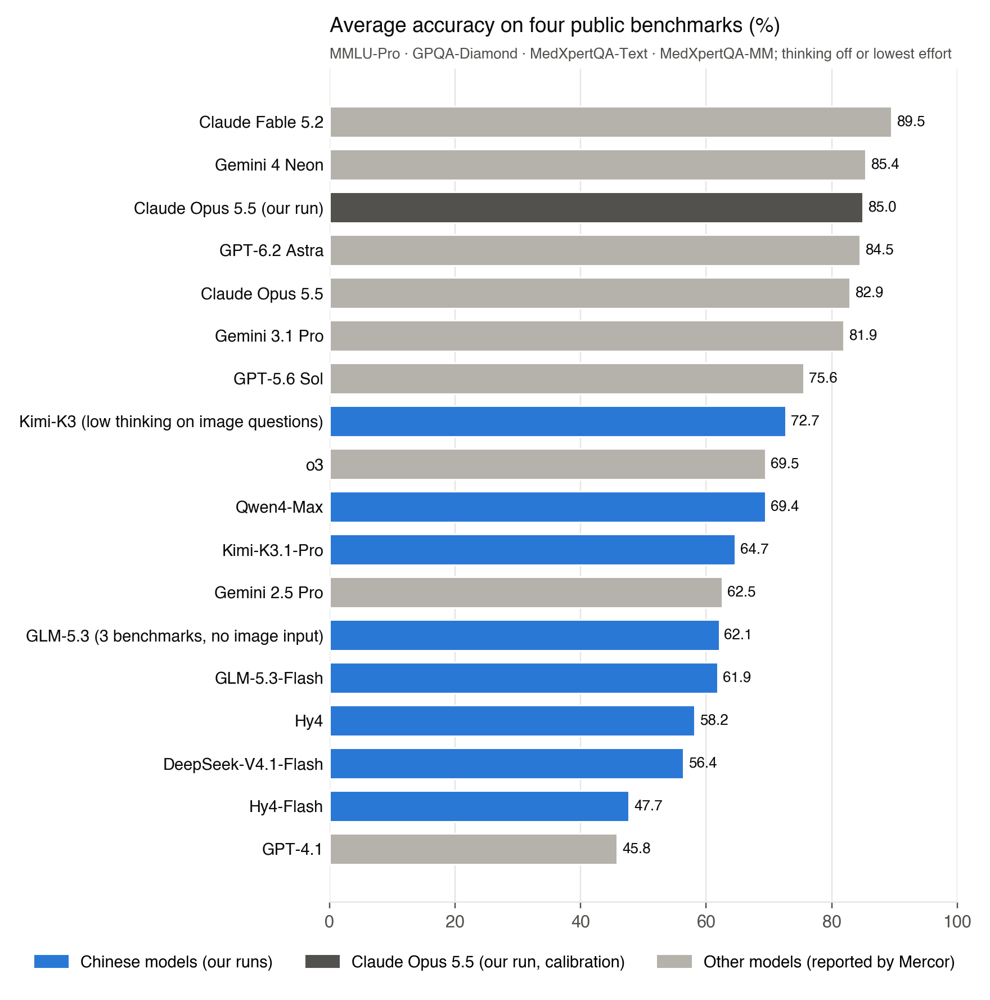
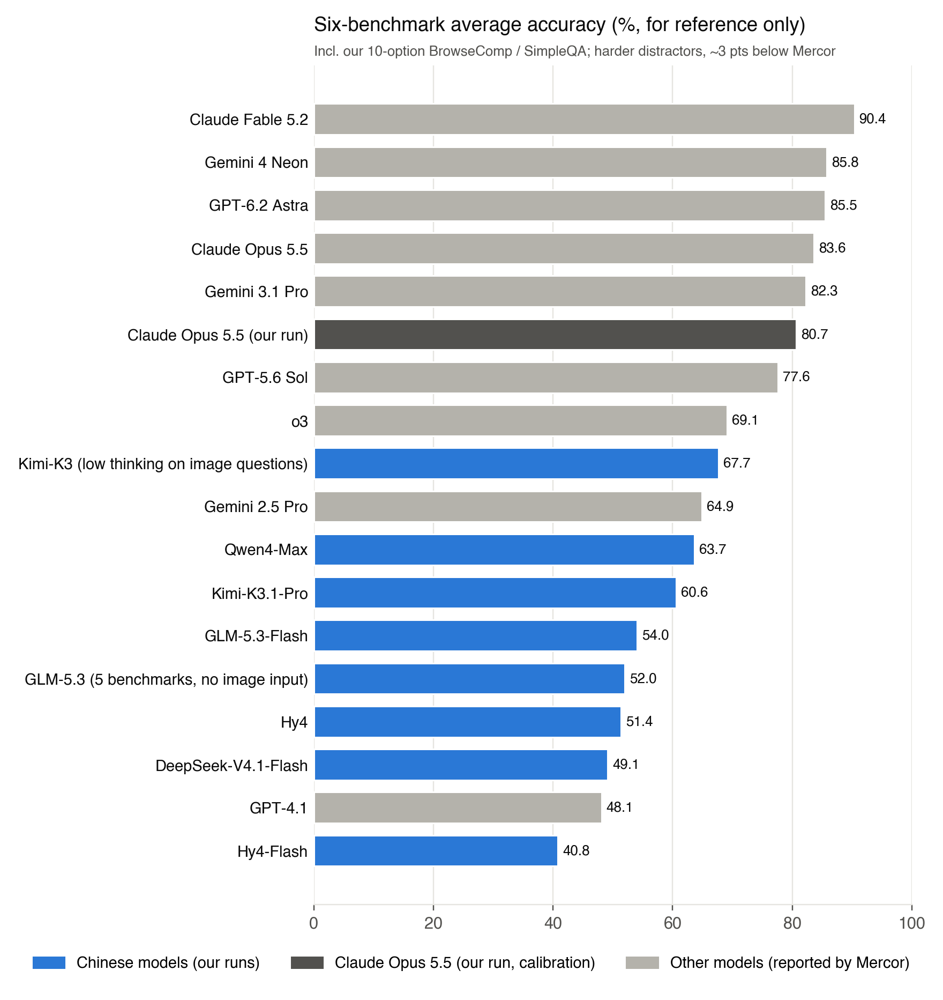
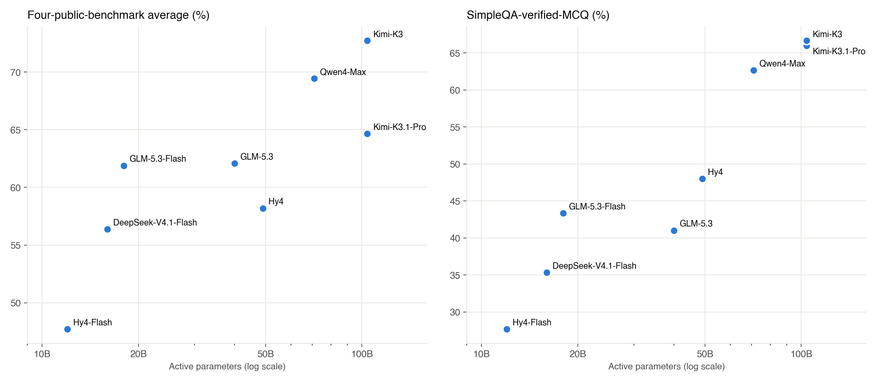
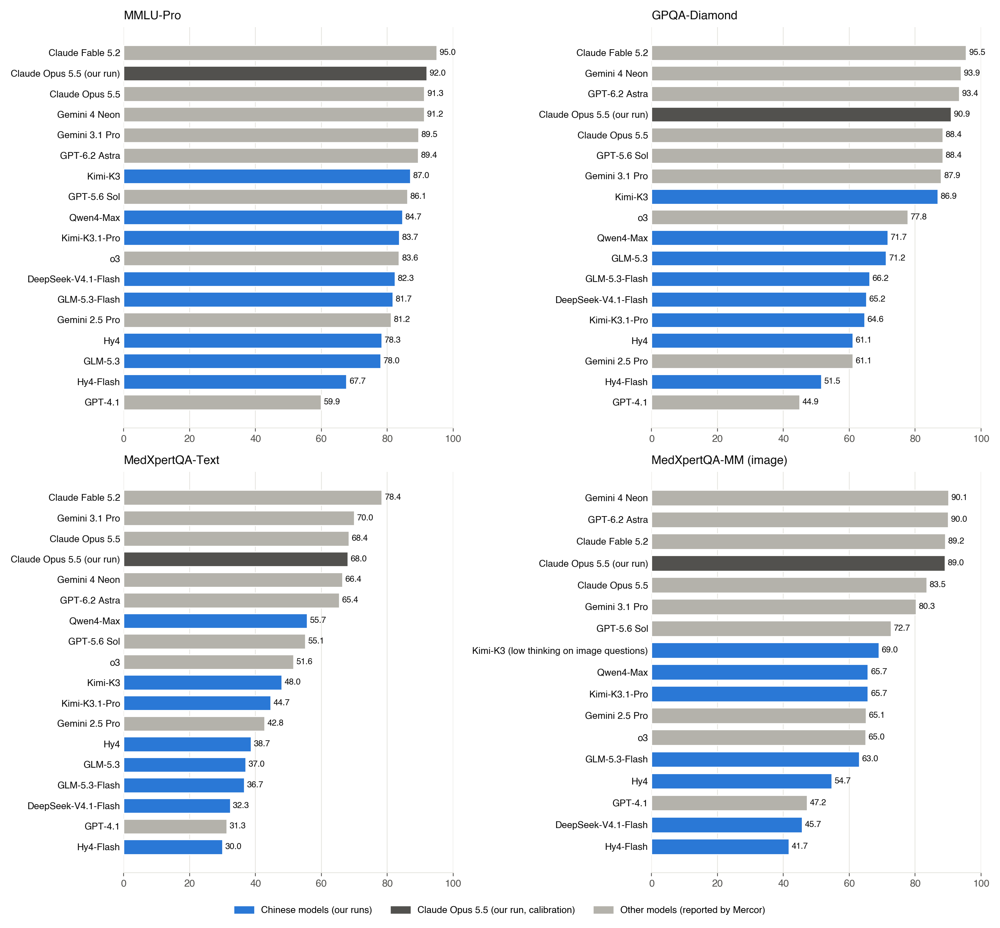
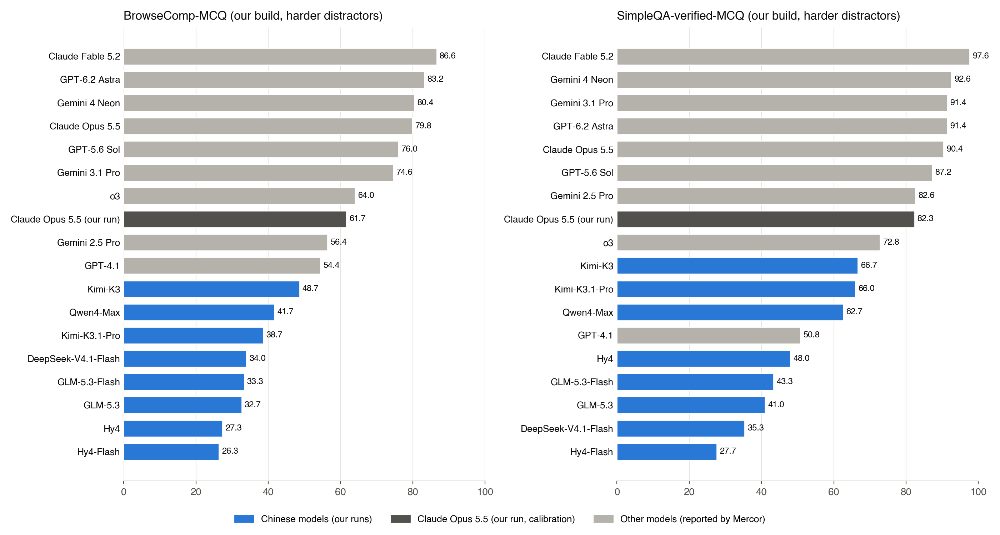

* toc
{:toc}

OpenAI recently published a loss curve for its base models: from GPT-3.5 to GPT-6.2 Astra, the cross-entropy of successive generations on OpenAI's internal codebase falls all the way to 0.76. Read through the lens of scaling laws, the curve suggests that base-model loss sets how much a model knows and where its ceiling lies, while reinforcement learning and inference-time compute decide how much of that ceiling gets realized. Think of pretraining as talent and RL post-training as practice: practice lets talent show, but it rarely raises the ceiling. The trouble is that this yardstick is hard to use outside OpenAI. The evaluation set is internal code, and a public codebase would probably show a similar trend; the real obstacle is that loss requires the probability the model assigns to the correct next token. You can compute that for open-weight models, but closed-model APIs return only sampled text, so the distribution, and with it the loss, is out of reach.

Jason Wei recently proposed a workaround on Mercor's blog [1]. He picks six multiple-choice benchmarks: MMLU-Pro, GPQA-Diamond, the text and image subsets of MedXpertQA, plus BrowseComp and SimpleQA-verified converted to 10-option multiple choice. Reasoning effort is set to the minimum, the model answers with a single letter, and the score is the unweighted mean of the six accuracies. On the nine models for which OpenAI has published loss, this average correlates with log-perplexity at −0.98.

Multiple choice works as a perplexity proxy because the two tasks are close in kind. During pretraining, the model produces a probability distribution over the full vocabulary at every step, and the loss measures how much probability lands on the correct token. With thinking turned off and only a letter allowed, the model does the same thing with the candidate set shrunk from hundreds of thousands of tokens to four to ten options; if the correct option ranks first, the answer is right. A model that consistently puts its probability on the right option across many such questions very likely assigns high probability to correct tokens in ordinary text too. Scoring looks at a single letter, so answer style and length don't matter. All you need is API access: one pass is under 1,700 questions and costs a few dollars to a little over ten.

This post applies the same yardstick to Chinese models. Through a single API gateway we tested Kimi K3 and K3.1-Pro, GLM-5.3 and GLM-5.3-Flash, DeepSeek-V4.1-Flash, Hunyuan Hy4 and Hy4-Flash, and Qwen4-Max, all with thinking disabled or at the lowest reasoning setting. To check that our setup lines up with Mercor's, we also re-ran Claude Opus 5.5, which appears in their chart, through the same pipeline as a calibration point. Method first, then results. Keep in mind that the goal is to approximate the innate ceiling of the pretrained base model, not how well the post-trained model gets work done.

## What the six benchmarks test

| Benchmark | Questions | Options | What it tests | Example |
|---|---|---|---|---|
| MMLU-Pro | 300 | mostly 10 | College-level knowledge across 14 subjects | How many labeled trees are there on 6 vertices? |
| GPQA-Diamond | 198 | 4 | PhD-written hard problems in physics, chemistry, biology | Which of phonon, skyrmion, magnon, pion is not associated with spontaneous symmetry breaking? |
| MedXpertQA-Text | 300 | 10 | US medical licensing and specialty board exams | At which intervertebral level does the adult dural sac end? |
| MedXpertQA-MM | 300 | 5 | Diagnosis from X-rays, CT, pathology images | Given an image, what is the diagnosis? |
| BrowseComp-MCQ | 300 | 10 | Obscure facts pinned down by stacked constraints | A person or work identified only by combining several conditions |
| SimpleQA-verified-MCQ | 300 | 10 | Long-tail facts answerable in one line | How many children did Hank Williams have? |

The first four test academic and medical knowledge; the last two test obscure facts. Those two were originally open-ended QA; Mercor attached nine wrong options to each question to make them 10-way multiple choice. With thinking off, the model has to rely on what it memorized during pretraining, which is the closest match to what perplexity measures.

## Method

Every model gets the same prompt: a system message asking for only the letter of the correct option, and a user message with the question, lettered options, and a trailing "Answer:". Temperature is 0 where the API allows it, and the output cap is 8,192 tokens. We first take a letter at the start of the reply, then an explicitly marked answer (such as "Answer: B" or a bolded letter); if neither exists, the item counts as a parse failure. Parse failures, truncations, and API errors are all scored as wrong. Each benchmark is sampled to 300 questions with a fixed random seed; GPQA-Diamond has only 198, so we use all of them. Mercor didn't publish which questions it sampled (for MMLU-Pro it first took a 2,000-question subset and then sampled from that), so the two question sets come from the same pools at the same size but are not guaranteed to match. Item-level alignment is impossible, but two random 300-question draws from the same pool should have similar difficulty distributions, and the Opus 5.5 calibration below checks exactly that.

Following Mercor, we disable thinking wherever possible and use the lowest setting where it can't be disabled. Vendors expose this switch through different parameters, so we tested each model individually. Behavior with thinking "off" varies a lot. The table shows average hidden reasoning tokens and visible output tokens per question on GPQA-Diamond:

| Model | Setting | Reasoning / visible output (GPQA, per question) |
|---|---|---|
| Hy4-Flash, Kimi K3.1-Pro, Qwen4-Max | Thinking off | 0 / 2–10, essentially just a letter |
| Hy4 | Thinking off | 47 / 2, still thinks briefly on hard questions |
| GLM-5.3-Flash | Thinking off | 198 / 4, still thinks for a while on hard questions |
| DeepSeek-V4.1-Flash | Thinking off | 0 / 263, sometimes writes out a solution before the letter |
| Kimi K3 | Thinking off; API only allows temperature 0.6 | 0 / 611, nearly always gives the letter followed by an explanation; on image questions thinking must be on for the model to see the image, so we use the lowest level there |
| GLM-5.3 | API won't disable thinking; low effort | 341 / 2; no image input, so no MedXpertQA-MM score |
| Claude Opus 5.5 | Thinking can't be disabled; low effort, same as Mercor | 241 / 5 |

"Thinking off" means different things for different vendors: some models still do a short hidden reasoning pass on hard questions, others move the reasoning into the visible reply. We test each model at the lowest setting its API offers and record the reasoning and visible tokens it actually spends; the full numbers for all six benchmarks are in the appendix. DeepSeek often writes a long analysis on BrowseComp first, and a small output cap would truncate it and score it wrong, hence the 8,192 cap. Kimi K3 gave no option letter on about 60 BrowseComp questions: some replies said the question requires web search, and most were simply empty. The test targets world knowledge memorized by the base model, and web access is out of scope, so these count as wrong. Even if it guessed randomly on all of them, BrowseComp would rise by only about 2 points and the six-benchmark average by 0.3, which doesn't change its rank.

## Building our own multiple-choice sets

Mercor hasn't released its 10-option versions of BrowseComp and SimpleQA; it only says GPT-OSS generated nine distractors per question. We built our own along the same lines, with stricter generation and filtering.

Distractors come from GPT-6.2 Sol, which is not among the models under test. The prompt requires the nine wrong options to match the correct answer in type, format, and granularity: a person's name is paired with names of people from the same country, era, and profession; a date with dates at the same precision; a number with numbers of similar magnitude and the same unit. Distractors must not be aliases, abbreviations, or paraphrases of the correct answer. They also must not all be small perturbations of the correct answer; otherwise the correct answer becomes the common factor among the options and is easy to spot. Some original SimpleQA answers carry grading notes, such as "390 m (acceptable range 386–394 m)". Left in place, these make the correct option noticeably longer than the rest, so we strip them first.

After generation we run an options-only filter. The question is hidden and a model sees only the ten options and must guess the correct one. With good distractors this is pure guessing, and accuracy should sit near 10%. Three models outside the test set do the guessing; if two of the three get it right, the question is flagged as leaky and sent back to GPT-6.2 Sol, along with the previous options, for a rewrite, up to three rounds. The first draft showed three common kinds of leak: all nine distractors were variants of the correct answer (for example, the same surname with different given names); the correct answer was the only real, well-known entity while the rest looked invented; or numeric options were distributed symmetrically around the true value.

| | Flagged in first draft | Still flagged after 3 rounds | Questions changed |
|---|---|---|---|
| BrowseComp | 51 / 300 | 3 | 51 |
| SimpleQA | 40 / 300 | 5 | 47 (7 of them format cleanup only) |

On BrowseComp, the three checker models' options-only accuracy dropped from 28%, 22%, and 13% to 16%, 13%, and 12%, close to the 10% chance level.

Our sets are harder than Mercor's. For the same Claude Opus 5.5, our scores on the four public benchmarks differ from Mercor's by −0.4 to +5.5 points, 2 points higher on average. On the two self-built sets, BrowseComp comes out at 61.7 versus 79.8 and SimpleQA at 82.3 versus 90.4, lower by 18 and 8 points. The public benchmarks agree and the gap sits entirely in the self-built sets, so it comes from the distractors. The filtering itself also made our questions harder and stricter.

We therefore report two averages. The four-public-benchmark average can be compared directly with Mercor's chart: for Opus 5.5 we get 85.0, Mercor reports 82.9. We also plot the six-benchmark average next to Mercor's numbers, but only as a reference: for the same Opus 5.5 we get 80.7 against Mercor's 83.6, about 3 points lower; the two self-built sets pull it down by 4.4 points and the four public ones recover some of that. Because our questions are stricter, six-benchmark averages in this post run systematically a few points below Mercor's. Comparisons among the Chinese models are unaffected, but against the non-Chinese models in Mercor's chart, ours start a few points behind.

## Four public benchmarks: where the Chinese models stand

Start with the four public benchmarks, which compare directly with Mercor. Light gray bars are the models Mercor reported, dark gray is our own Opus 5.5 run, and blue are the Chinese models.

The Kimi K3 family scores highest among the Chinese models. K3 gets 72.7, between GPT-5.6 Sol (75.6) and o3 (69.5), but its thinking can't be fully switched off: it needs thinking on to read images, and on text questions, even with thinking off, it attaches a long explanation to almost every answer (611 visible tokens per question on GPQA). Its score isn't strictly comparable with the others, so we label it separately. K3.1-Pro, built on the same base with thinking cleanly off, scores 64.7. Qwen4-Max scores 69.4, essentially tied with o3 and the highest among models whose thinking is cleanly off. GLM-5.3 and GLM-5.3-Flash both land around 62, level with Gemini 2.5 Pro (62.5). Our setup reads about 2 points above Mercor's on Opus 5.5; if the Chinese models carry the same offset, their positions shift down slightly. The frontier models, Fable 5.2, Gemini 4 Neon, and GPT-6.2 Astra, all sit around 85, more than 12 points above the best Chinese model.

Split by benchmark (per-benchmark charts are in the appendix), the gap is uneven. On MMLU-Pro the Chinese models mostly score between 78 and 87, and Kimi K3's 87.0 is only 5 points behind Opus 5.5's 92.0. On GPQA-Diamond, Kimi K3 reaches 86.9, close to Mercor's Opus 5.5 figure (88.4), while the other Chinese models range from 51 to 72. The medical benchmarks show the widest gaps: on MedXpertQA-Text, Opus 5.5 scores 68.0, the best Chinese model, Qwen4-Max, 55.7, and the rest 30 to 48; on the image subset, Opus 5.5 scores 89.0 and the best Chinese model, Kimi K3, 69.0. The MMLU family is the leaderboard every lab optimizes for, while medical specialty exam material is relatively scarce in Chinese corpora, so this pattern at the two extremes is roughly what one would expect.

## Adding the long-tail fact sets widens the gap

The six-benchmark average adds our 10-option BrowseComp and SimpleQA. As noted, these are harder than Mercor's versions: the same Opus 5.5 gets 80.7 here versus 83.6 from Mercor. Treat this chart as a reference only; the blue and dark gray bars would need a few more points to be on the same footing as the light gray ones. Kimi K3 is still on top (67.7, with the same caveat about its thinking), followed by Qwen4-Max (63.7) and Kimi K3.1-Pro (60.6). GLM-5.3-Flash, GLM-5.3, Hy4, and DeepSeek-V4.1-Flash fall between 49 and 54, and Hy4-Flash scores 40.8.

Compared with the public benchmarks, the Chinese models lose more ground on these two sets (per-benchmark charts in Figure 5 of the appendix). Taking our Opus 5.5 run on the same questions as the baseline, here is how far behind each model is:

| Model | Three public text benchmarks (no images) | BrowseComp | SimpleQA |
|---|---|---|---|
| Kimi K3 | −9.7 | −13.0 | −15.7 |
| Qwen4-Max | −13.0 | −20.0 | −19.7 |
| Kimi K3.1-Pro | −19.3 | −23.0 | −16.3 |
| GLM-5.3 | −21.6 | −29.0 | −41.3 |
| GLM-5.3-Flash | −22.1 | −28.3 | −39.0 |
| Hy4 | −24.3 | −34.3 | −34.3 |
| DeepSeek-V4.1-Flash | −23.7 | −27.7 | −47.0 |
| Hy4-Flash | −33.9 | −35.3 | −54.7 |

Long-tail facts have to be stored in the parameters, and SimpleQA scores line up almost exactly with model size: the two Kimi models and Qwen4-Max, all above 2T total parameters, score 63 to 67; Hy4 at 770B scores 48; Hy4-Flash at 220B scores just 27.7. Tuning for subject exams like MMLU and GPQA is comparatively easy, but the stock of memorized obscure facts is hard to make up for in post-training.

The two 10-option sets also discriminate better than the public benchmarks. On SimpleQA the Chinese models range from 27.7 to 66.7, a 39-point spread; on the three public text benchmarks they range only from 49.7 to 74.0, a 24-point spread. For probing world knowledge, the multiple-choice conversion works well.

## More parameters, more knowledge

Putting scores next to model size shows a clear trend. The three models above 2T total parameters (Kimi K3 and K3.1-Pro at 2.8T, Qwen4-Max at 2.4T) take the top three spots on the four-benchmark average; the smallest, Hy4-Flash (220B), comes last. Across the eight Chinese models, the Spearman correlation between active parameters and the four-benchmark average is 0.89, and with SimpleQA it is 0.97.

| Model | Total params | Active params | 4-benchmark avg | 6-benchmark avg |
|---|---|---|---|---|
| Kimi K3 | 2.8T | 104B | 72.7 | 67.7 |
| Qwen4-Max | 2.4T | 71B | 69.4 | 63.7 |
| Kimi K3.1-Pro | 2.8T | 104B | 64.7 | 60.6 |
| GLM-5.3 | 744B | 40B | 62.1 (3 benchmarks) | 52.0 (5 benchmarks) |
| GLM-5.3-Flash | 320B | 18B | 61.9 | 54.0 |
| Hy4 | 770B | 49B | 58.2 | 51.4 |
| DeepSeek-V4.1-Flash | 552B | 16B | 56.4 | 49.1 |
| Hy4-Flash | 220B | 12B | 47.7 | 40.8 |

## K3 and K3.1-Pro: same base, different results

Kimi K3 and K3.1-Pro have the same size and the same base model, yet their four-benchmark averages differ by 8 points. Most of the gap comes from GPQA-Diamond: K3 scores 86.9 and K3.1-Pro only 64.6, a 22-point difference.

SimpleQA measures how many facts the model has memorized, and with the same base the scores are the same. GPQA consists of PhD-level reasoning problems, which suffer most when thinking is turned off, and that is where the gap is largest. That is also exactly where the two models behave differently: K3.1-Pro replies with just a letter, while K3 attaches a long explanation to nearly every answer and, on a few questions, writes out its reasoning before answering. K3's thinking may not be fully off, and we can't yet tell how much of the extra 22 points on GPQA comes from that residual reasoning versus differences in post-training. If it is mainly post-training, then in terms of the opening analogy, the two models share the same talent but practiced differently, and one of them gets noticeably more out of it.

## What it cost

At each vendor's official list price, one pass over the ~1,700 questions costs:

| Model | Input tokens | Output tokens | Cost (CNY) |
|---|---|---|---|
| Hy4-Flash | 650K | 4K | 0.33 |
| GLM-5.3-Flash | 720K | 220K | 1.19 |
| Hy4 | 650K | 60K | 4.91 |
| Qwen4-Max | 680K | 20K | 7.52 |
| DeepSeek-V4.1-Flash | 520K | 860K | 7.88 |
| GLM-5.3 (no image questions) | 310K | 330K | 11.72 |
| Kimi K3.1-Pro | 760K | 90K | 15.81 |
| Claude Opus 5.5 | 890K | 420K | 86.36 |
| Kimi K3 | 780K | 850K | 100.15 |

The eight Chinese models cost about ¥150 in total, and Kimi K3 alone accounts for ¥100: it explains every answer, producing nearly ten times as many output tokens as K3.1-Pro, at an output price of ¥100 per million tokens. DeepSeek-V4.1-Flash also writes long analyses on BrowseComp and produces about as many output tokens as K3, but at a far lower price it costs under ¥8 in total. Hy4-Flash replies with little more than a letter and ran the full suite for ¥0.33.

## Limitations

With only 300 questions per benchmark, the standard error is 2 to 3.5 points for a single benchmark and about 1 to 1.5 points for the six-benchmark average. Models within a point or two of each other can't be reliably ranked.

Vendors disable thinking to different degrees. GLM-5.3 and Opus 5.5 can't turn it off and run at low effort; Kimi K3's API only allows temperature 0.6 and needs thinking on for image questions; GLM-5.3-Flash and Hy4 still spend tens to about two hundred hidden reasoning tokens on hard questions with thinking off. The tokens each model actually spent are listed in the appendix.

## Wrapping up

With thinking turned off, the Chinese models with the most pretraining knowledge are the Kimi K3 family and Qwen4-Max. K3.1-Pro and Qwen4-Max fall between o3 and Gemini 2.5 Pro; K3 scores higher, but its thinking couldn't be fully disabled, and much of the extra margin may come from that residual reasoning. All of them trail the Fable 5.2 and GPT-6.2 Astra generation by more than ten points. The gap is largest on specialist medical knowledge and long-tail facts, and smallest on heavily optimized subject benchmarks like MMLU-Pro. Scores track model size closely, especially on long-tail facts.

Our evaluation code, the options for the two self-built 10-option sets, and the score table are open-sourced at [refraction-ray/perplexity-proxy](https://github.com/refraction-ray/perplexity-proxy).

## Appendix

Per-benchmark scores:

Average reasoning tokens / visible output tokens per question:

| Model | MMLU-Pro | GPQA-D | MedX-Text | MedX-MM | BrowseComp | SimpleQA |
|---|---|---|---|---|---|---|
| Claude Opus 5.5 | 102 / 3 | 241 / 5 | 244 / 3 | 164 / 3 | 532 / 4 | 189 / 3 |
| Kimi K3 | 0 / 228 | 0 / 611 | 0 / 313 | 665 / 13 | 0 / 1043 | 0 / 154 |
| Qwen4-Max | 0 / 4 | 0 / 10 | 0 / 3 | 0 / 2 | 0 / 62 | 0 / 3 |
| Kimi K3.1-Pro | 0 / 8 | 0 / 8 | 0 / 7 | 0 / 30 | 0 / 231 | 0 / 11 |
| GLM-5.3-Flash | 46 / 3 | 198 / 3 | 36 / 3 | 37 / 3 | 420 / 3 | 38 / 3 |
| GLM-5.3 | 48 / 2 | 341 / 2 | 38 / 2 | — | 747 / 2 | 28 / 2 |
| Hy4 | 59 / 5 | 47 / 2 | 27 / 2 | 31 / 2 | 0 / 29 | 0 / 2 |
| DeepSeek-V4.1-Flash | 0 / 45 | 0 / 263 | 0 / 3 | 0 / 13 | 0 / 2618 | 0 / 1 |
| Hy4-Flash | 0 / 2 | 0 / 2 | 0 / 2 | 0 / 2 | 0 / 2 | 0 / 2 |

Full scores:

| Model | MMLU-Pro | GPQA-D | MedX-Text | MedX-MM | BrowseComp | SimpleQA | 4-benchmark avg | 6-benchmark avg |
|---|---|---|---|---|---|---|---|---|
| Claude Opus 5.5 | 92.0 | 90.9 | 68.0 | 89.0 | 61.7 | 82.3 | 85.0 | 80.7 |
| Kimi K3 | 87.0 | 86.9 | 48.0 | 69.0 | 48.7 | 66.7 | 72.7 | 67.7 |
| Qwen4-Max | 84.7 | 71.7 | 55.7 | 65.7 | 41.7 | 62.7 | 69.4 | 63.7 |
| Kimi K3.1-Pro | 83.7 | 64.6 | 44.7 | 65.7 | 38.7 | 66.0 | 64.7 | 60.6 |
| GLM-5.3-Flash | 81.7 | 66.2 | 36.7 | 63.0 | 33.3 | 43.3 | 61.9 | 54.0 |
| GLM-5.3 | 78.0 | 71.2 | 37.0 | — | 32.7 | 41.0 | 62.1 (3 benchmarks) | 52.0 (5 benchmarks) |
| Hy4 | 78.3 | 61.1 | 38.7 | 54.7 | 27.3 | 48.0 | 58.2 | 51.4 |
| DeepSeek-V4.1-Flash | 82.3 | 65.2 | 32.3 | 45.7 | 34.0 | 35.3 | 56.4 | 49.1 |
| Hy4-Flash | 67.7 | 51.5 | 30.0 | 41.7 | 26.3 | 27.7 | 47.7 | 40.8 |

## References

1. J. Wei, [A simple proxy for perplexity](https://www.mercor.com/blog/a-simple-proxy-for-perplexity/)
2. Y. Wang et al., [MMLU-Pro](https://arxiv.org/abs/2406.01574)
3. D. Rein et al., [GPQA](https://arxiv.org/abs/2311.12022)
4. Y. Zuo et al., [MedXpertQA](https://arxiv.org/abs/2501.18362)
5. J. Wei et al., [BrowseComp](https://arxiv.org/abs/2504.12516)
6. L. Haas et al., [SimpleQA Verified](https://arxiv.org/abs/2509.07968)
